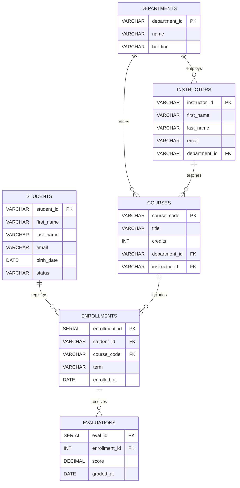

# Entity-Relationship Documentation & Normalization Rules

## 1. Entities & Cardinalities

## 2. Integrity Constraints Enforced
1. **Primary Keys:** Unique identity on every table.
2. **Foreign Keys with Referential Integrity:** `ON DELETE RESTRICT` to prevent orphan academic records.
3. **CHECK Constraints:**
   * Scores must strictly fall between `0.0` and `100.0`.
   * Course credits must be greater than `0`.
   * Email must contain valid `@` structure.
4. **UNIQUE Constraints:** Composite uniqueness on `(student_id, course_code, term)` preventing accidental double-enrollment in the same academic semester.
